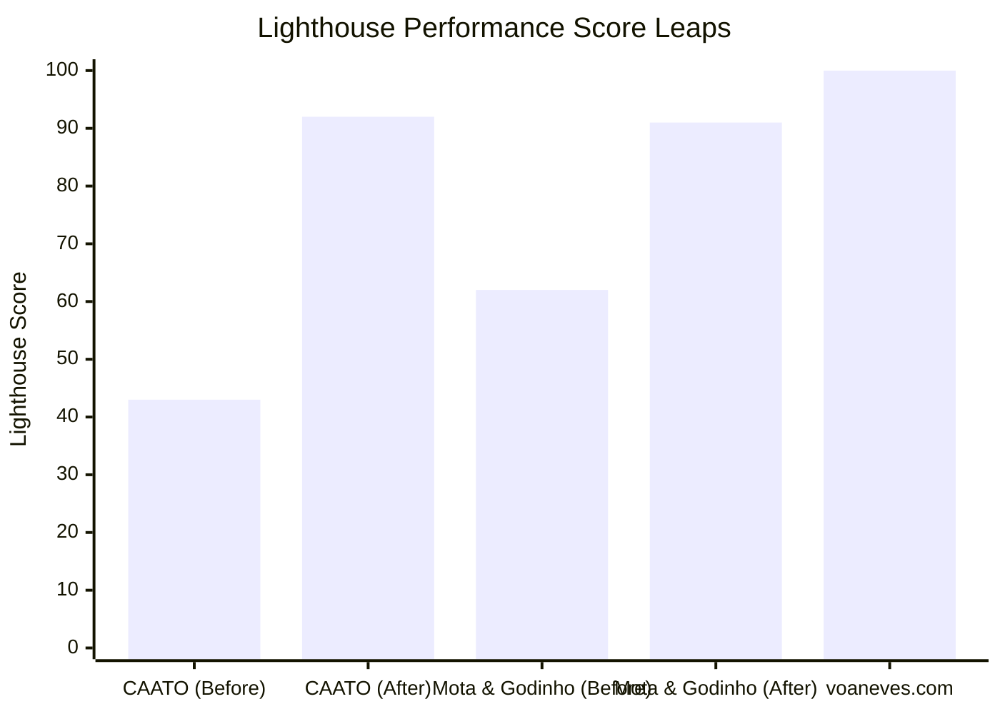
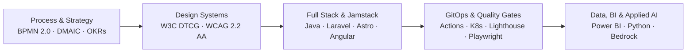

🇺🇸 <strong>English</strong> · <a href="./README.pt-br.md">🇧🇷 Versão em Português (PT-BR)</a>

<a href="https://voaneves.com/en/">
  <picture>
    <source media="(prefers-color-scheme: dark)" srcset="./assets/brand/mark-dark.svg" />
    <source media="(prefers-color-scheme: light)" srcset="./assets/brand/mark-light.svg" />
    
  </picture>
</a>

 

<a href="https://voaneves.com/en/">
  <picture>
    <source media="(prefers-color-scheme: dark)" srcset="./assets/brand/wordmark-dark.svg" />
    <source media="(prefers-color-scheme: light)" srcset="./assets/brand/wordmark-light.svg" />
    
  </picture>
</a>

<h3>Victor Neves — Full Stack Developer, Design Systems &amp; Applied AI</h3>

  <strong>Signal, not noise.</strong> Design, data, and production code — minus the noise. 
  
    <kbd>W3C DTCG</kbd> · <kbd>WCAG 2.2 AA</kbd> · <kbd>GitOps</kbd> · <kbd>BPMN 2.0</kbd> · <kbd>Amazon Bedrock</kbd> 
    Serving Brazil and worldwide, remote or hybrid · <code>voaneves</code> · 🇧🇷 Atendimento em PT, EN &amp; ES
  

Need something like this? <a href="https://voaneves.com/en/#contact"><strong>Let's talk →</strong></a>

  
  
  
  

  <a href="#about">About</a> ·
  <a href="#impact">Impact</a> ·
  <a href="#architecture">Workflow</a> ·
  <a href="#capabilities">Capabilities</a> ·
  <a href="#projects">Projects</a> ·
  <a href="#awards">Awards</a> ·
  <a href="#contact">Contact</a>

  
<strong>Table of Contents</strong> — navigate every section

  <ol>
    <li><a href="#about">Executive Positioning</a></li>
    <li><a href="#impact">Measurable Impact (KPIs &amp; Lighthouse Chart)</a></li>
    <li><a href="#architecture">End-to-End Engineering Workflow</a></li>
    <li><a href="#capabilities">Five Core Capabilities</a></li>
    <li><a href="#projects">Flagship Spotlights &amp; Repositories</a></li>
    <li><a href="#awards">Awards, Credentials &amp; Full Career Trajectory</a></li>
    <li><a href="#contact">Consulting &amp; Direct Contact</a></li>
  </ol>

<picture>
  <source media="(prefers-color-scheme: dark)" srcset="./assets/brand/rule-dark.svg" />
  <source media="(prefers-color-scheme: light)" srcset="./assets/brand/rule-light.svg" />
  
</picture>

## 👋 About

> [!NOTE]
> **Engineering rigor meets measurable product craft.** Mechanical Engineer (**UNICAMP**, 2012–2018), Postgraduate in **BI, Big Data & Artificial Intelligence** (**Faculdade Focus**, 2023–2024), and **B.Sc. in Information Systems** candidate (**XP Educação**, 2023–2027). Coding since age 11.

I am **Victor Otávio Andrade das Neves (Victor Neves)**, combining process architecture (BPMN), business intelligence (BI), applied AI, and full stack web engineering into production deliveries — from design tokens to resilient deploys:

- **Web Design Analyst @ ALETO** *(Mar 2026–)*: design system engineering, full stack development, GitOps pipelines, and docs-as-code.
- **Founder & Consultant @ [voaneves.com][site-en]** *(2019–)*: `40+` BI dashboards, high-Lighthouse Jamstack sites, apps, and WCAG 2.2 accessibility gates.
- **Grant Evaluator @ Projeto Centelha** *(2023–)*: technical reviewer for Big Data, AI, and Engineering innovation grants.
- **Former Process Office Manager, Technical Analyst & Innovation Agent @ SEBRAE Tocantins** *(2022–2026)*[^1]: led `+50` BPMN 2.0 mappings, `+76%` SMB productivity uplift, and `13+` AI workshops.

## 📈 By the Numbers

<table>
  <tr>
    <td width="25%" align="center">
      <h3>8+ yrs</h3>
      Data, processes &amp; production code shipped
    </td>
    <td width="25%" align="center">
      <h3>40+</h3>
      Web apps, sites &amp; Jamstack products delivered
    </td>
    <td width="25%" align="center">
      <h3>40+</h3>
      Executive Power BI &amp; Qlik Sense dashboards
    </td>
    <td width="25%" align="center">
      <h3>+50</h3>
      BPMN 2.0 processes mapped &amp; optimized
    </td>
  </tr>
  <tr>
    <td width="25%" align="center">
      <h3>+76%</h3>
      SMB productivity uplift in SEBRAE cycle 1
    </td>
    <td width="25%" align="center">
      <h3>+32%</h3>
      Quarterly OKR goal completion rate
    </td>
    <td width="25%" align="center">
      <h3>+236%</h3>
      Organic reach growth at MTE (UNICAMP)
    </td>
    <td width="25%" align="center">
      <h3>91–100</h3>
      Lighthouse leaps: <del>43</del> → <strong>92</strong> · <del>62</del> → <strong>91</strong>
    </td>
  </tr>
</table>

Verified production web performance improvements across client deliveries[^2][^3]:

<picture>
  <source media="(prefers-color-scheme: dark)" srcset="./assets/brand/rule-dark.svg" />
  <source media="(prefers-color-scheme: light)" srcset="./assets/brand/rule-light.svg" />
  
</picture>

## 🧭 How Design, Data &amp; Code Connect

## 🛠️ Core Capabilities

<table>
  <tr>
    <td width="50%" valign="top">
      <h3>1. Full Stack &amp; Web Engineering</h3>
      
<strong>Back-end:</strong> Java, PHP &amp; Laravel, Python &amp; FastAPI, Node.js, REST, SQL &amp; NoSQL

      
<strong>Front-end &amp; Jamstack:</strong> Angular, React, Next.js, Astro, Vite, TypeScript, JS, HTML5, CSS &amp; Sass; decoupled APIs, headless CMS &amp; CDN deploys

      
<strong>Mobile, Edge &amp; Quality:</strong> React Native, Flutter, PWA; Cloudflare Pages &amp; Workers, AWS, GCP; Lighthouse CI, Playwright, axe-core, Core Web Vitals &amp; technical SEO (hreflang, canonical, structured data)

    </td>
    <td width="50%" valign="top">
      <h3>2. Design &amp; Design Systems</h3>
      
<strong>Tokens &amp; Specs:</strong> Figma, interactive prototypes &amp; W3C <strong>DTCG 2025.10</strong> design tokens

      
<strong>Architecture:</strong> Token-driven CSS, component libraries, Architecture Decision Records (ADRs) &amp; npm visual-identity packaging

      
<strong>Accessibility:</strong> Automated <strong>WCAG 2.2 AA</strong> &amp; APCA-W3 contrast gates from token JSON through rendered UI

    </td>
  </tr>
  <tr>
    <td width="50%" valign="top">
      <h3>3. Infrastructure, GitOps &amp; Delivery</h3>
      
<strong>GitOps:</strong> Desired state in Git, deploy on merge, deterministic rollback on revert

      
<strong>CI/CD &amp; Containers:</strong> GitHub Actions, Forgejo Actions, Docker, Docker Compose &amp; <strong>Kubernetes</strong> manifests

      
<strong>Governance:</strong> Cloudflare, AWS &amp; GCP hosting; docs-as-code with zero secrets in Git

    </td>
    <td width="50%" valign="top">
      <h3>4. Data, BI &amp; Applied AI</h3>
      
<strong>BI &amp; Modeling:</strong> Power BI, Qlik Sense &amp; Tableau (<code>40+</code> dashboards); SQL, NoSQL, Hadoop &amp; MongoDB

      
<strong>Data Science:</strong> Python, Pandas, NumPy, Jupyter, Julia, ETL pipelines &amp; linear optimization

      
<strong>AI &amp; ML:</strong> Amazon Bedrock LLMs, prompt engineering, automations (<code>13+</code> workshops), Reinforcement Learning (DQN), CNNs &amp; NLP

    </td>
  </tr>
  <tr>
    <td colspan="2" valign="top">
      <h3>5. Processes, Management &amp; Strategy</h3>
      
<strong>BPM &amp; Quality:</strong> <strong>BPMN 2.0</strong> (<code>+50</code> processes), AS-IS/TO-BE mapping, low-code automation, Lean Six Sigma Green Belt, <strong>DMAIC</strong>, Scrum, Kanban &amp; risk control · <strong>Strategy:</strong> OKRs (<code>+32%</code> goals), Balanced Scorecard, BCG Matrix, McKinsey 7S, SWOT &amp; SEBRAE SMB productivity methodology (<code>+76%</code>).

    </td>
  </tr>
</table>

Single source of truth for positioning &amp; keywords (PT-BR): [`brand/docs/perfil-tecnico.md`][brand-perfil][^4] · Visual spec: [`README Brand System`](./docs/README-BRAND-SYSTEM.md).

<picture>
  <source media="(prefers-color-scheme: dark)" srcset="./assets/brand/rule-dark.svg" />
  <source media="(prefers-color-scheme: light)" srcset="./assets/brand/rule-light.svg" />
  
</picture>

## 🚀 Featured Projects

<table>
  <tr>
    <td width="50%" valign="top">
      <h3>👁️ <a href="https://github.com/voaneves/dtcg-contrast">dtcg-contrast</a></h3>
      
Zero-dependency WCAG 2.2 &amp; APCA contrast gate, SARIF 2.1.0 analyzer, and hue-preserving OKLCH auto-fixer for W3C DTCG 2025.10 tokens.

      
<a href="https://www.npmjs.com/package/dtcg-contrast"><strong>npm package</strong></a> · <a href="https://github.com/voaneves/dtcg-contrast"><strong>GitHub Action</strong></a>

    </td>
    <td width="50%" valign="top">
      <h3>🎨 <a href="https://github.com/voaneves/brand">brand (@voaneves/brand)</a></h3>
      
Canonical brand identity &amp; W3C DTCG design system: Concept B (Sinal) geometry, tokens, layered CSS, vanilla ES modules, icons &amp; WCAG 2.2 AA.

      
<a href="https://github.com/voaneves/brand"><strong>Inspect Design System</strong></a>

    </td>
  </tr>
  <tr>
    <td width="50%" valign="top">
      <h3>🌐 <a href="https://github.com/voaneves/site">site (voaneves.com)</a></h3>
      
Bilingual consulting portfolio built with Astro, Cloudflare Pages, GitOps workflows, automated Playwright/a11y tests, and Lighthouse 100.

      
<a href="https://voaneves.com/en/"><strong>Live Site</strong></a> · <a href="https://voaneves.com/en/#portfolio"><strong>Case Studies</strong></a>

    </td>
    <td width="50%" valign="top">
      <h3>🐍 <a href="https://github.com/voaneves/snake-arena">snake-arena</a></h3>
      
Reproducible Keras 3 benchmark comparing 14 Reinforcement Learning algorithms on Snake, backed by 749 automated pytest tests.

      
<a href="https://github.com/voaneves/snake-arena"><strong>Explore Benchmark</strong></a>

    </td>
  </tr>
</table>

  
<strong>More open-source tools, games &amp; client sites</strong>

  | Project | Summary | Live |
  | :-- | :-- | :-- |
  | 🎮 [**snake-on-pygame**](https://github.com/voaneves/snake-on-pygame) | Classic Snake in Python &amp; Pygame playable by human or trained DQN agent | [Docs](https://voaneves.github.io/snake-on-pygame/) |
  | 🎧 [**paru-site**](https://github.com/voaneves/paru-site) | Official website for DJ &amp; producer PARU built with Vite, React &amp; TypeScript | [Live site](https://voaneves.github.io/paru-site/) |
  | 🏰 [**travian-building-order**](https://github.com/voaneves/travian-building-order) | Algorithmic village building queue optimizer for Travian | [Live app](https://voaneves.github.io/travian-building-order/) |
  | 🐷 [**meupoupig**](https://github.com/voaneves/meupoupig) | Interactive financial-education and investing PWA game | [Play here](https://voaneves.github.io/meupoupig/) |

Full case studies (MTE, BI dashboards, CAATO, Mota &amp; Godinho, Boas Obras) at [voaneves.com/en/#portfolio][portfolio-en] · [All repositories][all-repos].

<picture>
  <source media="(prefers-color-scheme: dark)" srcset="./assets/brand/rule-dark.svg" />
  <source media="(prefers-color-scheme: light)" srcset="./assets/brand/rule-light.svg" />
  
</picture>

## 🏆 Awards &amp; Credentials

Bootcamp track record: **4× 1st place + 1× 2nd place** across national engineering &amp; AI cohorts.

- 🥇 **1st place** — Santander Bootcamp 2025: Back-End with Python (FastAPI, Docker, MongoDB).
- 🥈 **2nd place** — Santander Bootcamp 2025: Data Science with Python.
- 🥇 **1st place** — Santander 2024: AWS Cloud Practitioner Certification Prep.
- 🥇 **1st place** — Bootcamp Nexa 2024: Generative AI Foundations (AWS, Amazon Bedrock).
- 🥇 **1st place** — Santander Bootcamp 2023: Data Science with Python (out of **17,600 participants**).
- 🥇 **1st place** — "Estratégia em Alto Mar" (SEBRAE Tocantins, 2024).
- 🎓 **Certifications:** Lean Six Sigma Green Belt · Google Project Management &amp; Data Analytics · University of Cambridge (*Skills for the Green Transition*) · PwC (*Data-driven Decision Making* &amp; Advanced Excel) · AWS Prep &amp; Generative AI Foundations (DIO, AWS, Amazon Bedrock) · Accenture &amp; Huawei ICT Academy (AI) · EF SET English C2 (84/100).

  
<strong>🧬 Full Career Trajectory &amp; Education (2012–Present · 11 roles)</strong>

  | Period | Organization | Role / Focus |
  | :-- | :-- | :-- |
  | 2026– | **ALETO** | Web Design Analyst: design system, full stack development, GitOps &amp; docs-as-code |
  | 2023–2027 | **XP Educação** | B.Sc. in Information Systems |
  | 2023–2024 | **Faculdade Focus** | Postgraduate degree in BI, Big Data &amp; Artificial Intelligence |
  | 2023– | **Projeto Centelha** | Grant evaluator for Big Data, AI &amp; Engineering projects |
  | 2022–2026 | **SEBRAE Tocantins** | Local Innovation Agent (2022), Technical Analyst (2023) &amp; Process Office Manager (2024): `+76%` SMB productivity, `+50` BPMN 2.0 processes, `+32%` quarterly goals, `13+` AI workshops |
  | 2019– | **voaneves.com** | Consultant &amp; Web Developer: `40+` BI dashboards, sites &amp; apps |
  | 2019–2022 | **Damásio Educacional** | Franchise Supervisor |
  | 2017–2019 | **Coca-Cola FEMSA** | Maintenance Intern (DMAIC) &amp; Strategic Planning Trainee |
  | 2014–2018 | **MTE (UNICAMP)** | Member &amp; Marketing Director (`+236%` organic reach) |
  | 2018 | **Krones AG**, Germany | Summer Intern in Industrial Engineering |
  | 2012–2018 | **UNICAMP** | Mechanical Engineering &amp; Materials Science undergraduate research (PIBIC/CNPq) |

  
<strong>🌎 Languages, Volunteering &amp; Super Mario World Career Timeline</strong>

  - 🗣️ Portuguese (native) · English C2 (EF SET 84/100) · Spanish C1 · Korean B1 · German A2.
  - 📚 Manga, manhwa, anime, and online games (which is how I learned English).
  - 🗺️ Google Local Guide Level 6.
  - 🤝 Volunteer since 2013: ONG Sonhar Acordado and ONG Boas Obras (where I built the organization's website).
  - 🍄 [Interactive Super Mario World career timeline](https://voaneves.github.io/timeline/)

  

<picture>
  <source media="(prefers-color-scheme: dark)" srcset="./assets/brand/rule-dark.svg" />
  <source media="(prefers-color-scheme: light)" srcset="./assets/brand/rule-light.svg" />
  
</picture>

## 🤝 Work Together

<dl>
  <dt><strong>Design Systems &amp; Accessibility Audits</strong></dt>
  <dd>W3C DTCG 2025.10 token pipelines, WCAG 2.2 AA / EAA compliance audits, APCA perceptual contrast verification, and Figma-to-code component libraries.</dd>
  <dt><strong>Web &amp; Full Stack Platforms</strong></dt>
  <dd>Production sites and web apps in Astro, Angular, Laravel, Java, and Cloudflare Pages/Workers engineered for Core Web Vitals and Lighthouse 90+.</dd>
  <dt><strong>GitOps, BI &amp; Applied AI</strong></dt>
  <dd>Automated CI/CD quality gates (Lighthouse CI, Playwright, axe-core), executive Power BI dashboards, and Amazon Bedrock LLM automations.</dd>
</dl>

  <a href="https://voaneves.com/en/#contact"><picture><source media="(prefers-color-scheme: dark)" srcset="https://raw.githubusercontent.com/voaneves/voaneves/main/assets/buttons/hire-dark.svg" /></picture></a>
  <a href="https://voaneves.com/en/"><picture><source media="(prefers-color-scheme: dark)" srcset="https://raw.githubusercontent.com/voaneves/voaneves/main/assets/buttons/site-dark.svg" /></picture></a>

  <strong>Available worldwide · Remote / Hybrid</strong> 
  <a href="https://www.linkedin.com/in/voaneves/"><strong>💼 LinkedIn</strong></a> ·
  <a href="mailto:victorneves478@gmail.com"><strong>✉️ E-mail</strong></a>

  
   
  <strong>VOANEVES.</strong> · Signal, not noise. · <a href="https://voaneves.com/en/">voaneves.com</a>

<a href="#top">↑ Back to top</a>

[^1]: SEBRAE Tocantins cycle-1 SMB productivity uplift (`+76%`), Process Office BPMN 2.0 mappings (`+50`), and quarterly goal completion (`+32%`).
[^2]: CAATO &amp; Mota &amp; Godinho production web performance rebuilds documented in [voaneves.com/en/#portfolio](https://voaneves.com/en/#portfolio).
[^3]: MTE UNICAMP Marketing Directorate organic reach growth (`+236%`).
[^4]: Canonical positioning &amp; taxonomy stored in [`@voaneves/brand`](https://github.com/voaneves/brand/blob/main/docs/perfil-tecnico.md).

[site-en]: https://voaneves.com/en/
[portfolio-en]: https://voaneves.com/en/#portfolio
[brand-perfil]: https://github.com/voaneves/brand/blob/main/docs/perfil-tecnico.md
[all-repos]: https://github.com/voaneves?tab=repositories
