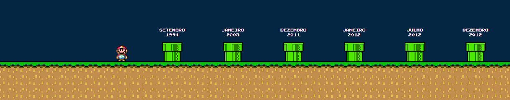

# Victor Neves · Desenvolvedor Full Stack e Webdesigner

**Design, código, infraestrutura e dados em uma só entrega.**
 
Full stack developer and web designer · Java, PHP/Laravel, Angular, Jamstack · GitOps, serverless, BI and AI · Mechanical engineer by training.

## 👋 Sobre

Sou **Victor Otávio Andrade das Neves (Victor Neves)**, **engenheiro mecânico pela UNICAMP que virou desenvolvedor**, com pós-graduação em BI, Big Data e Inteligência Artificial, e uso as duas formações juntas: rigor de processo, leitura de dados e código que vai para produção. Desenvolvo de ponta a ponta, do protótipo no Figma ao deploy, em várias stacks: **Java, PHP e Laravel, Angular, React, Astro, Vite e Jamstack**, com arquiteturas **serverless** e entrega por **GitOps**.

Programo desde os 11 anos, quando montei o meu primeiro blog. Hoje trabalho como **Analista Webdesigner na ALETO**. Antes passei pelo **SEBRAE Tocantins**, como Agente Local de Inovação, Analista Técnico e Gestor do Escritório de Processos, e sigo como avaliador de projetos de Big Data, IA e Engenharia no **Projeto Centelha**.

## 📈 Em números

| 8+ anos | 40+ projetos | 11 organizações | +76% | Lighthouse |
| :-: | :-: | :-: | :-: | :-: |
| dados, processos e código | web, apps e BI entregues | atendidas | produtividade de MPEs no 1º ciclo | 43 → 92 e 62 → 91 em dois sites auditados |

## 🛠️ O que eu faço

| Frente | Como |
| :-- | :-- |
| **Full stack** | Java · PHP e Laravel · Python e FastAPI · Node.js · Angular · React · Next.js · Astro · Vite · TypeScript · REST · SQL e NoSQL |
| **Jamstack e serverless** | Sites estáticos e híbridos, APIs desacopladas, Cloudflare Pages e Workers, AWS, GCP |
| **Design e design system** | Figma · tokens W3C · biblioteca de componentes · WCAG 2.2 AA · identidade visual como pacote npm |
| **GitOps e entrega** | Estado em repositório, deploy por merge, CI/CD (GitHub e Forgejo Actions), Docker, documentação como código |
| **Qualidade e SEO técnico** | Lighthouse CI, Playwright, axe-core, Core Web Vitals, dados estruturados |
| **Dados, BI e IA** | Power BI · Qlik Sense · Python · Pandas · ETL · LLMs e automações · Reinforcement Learning |
| **Processos** | BPMN 2.0 · Lean Six Sigma Green Belt · OKRs · Scrum e Kanban |

Lista completa de competências, certificações e palavras-chave: [perfil técnico](https://github.com/voaneves/brand/blob/main/docs/perfil-tecnico.md).

## 🚀 Projetos em destaque

| | Projeto | Em uma linha |
| :-: | :-- | :-- |
| 🌐 | [**site**](https://github.com/voaneves/site) | Meu site ([voaneves.com](https://voaneves.com)): Astro, Cloudflare Pages, testes e Lighthouse 100. |
| 🎨 | [**brand**](https://github.com/voaneves/brand) | Identidade visual e design system como pacote npm: tokens, CSS, JS, fontes, ícones. |
| 🎧 | [**paru-site**](https://github.com/voaneves/paru-site) | Site oficial do DJ e produtor PARU, fiel ao brand guideline. Vite, React e TypeScript. |
| 🐍 | [**snake-arena**](https://github.com/voaneves/snake-arena) | Benchmark reprodutível de algoritmos de Reinforcement Learning no Snake. |
| 🎮 | [**snake-on-pygame**](https://github.com/voaneves/snake-on-pygame) | Cobrinha em Pygame, jogável por humano ou por IA (DQN). [Jogue online](https://voaneves.github.io/snake-on-pygame/). |
| 🏰 | [**travian-building-order**](https://github.com/voaneves/travian-building-order) | Otimiza a fila de construção da sua vila no Travian. |
| 🐷 | [**meupoupig**](https://github.com/voaneves/meupoupig) | Aprenda a investir jogando. [Jogue aqui](https://voaneves.com/meupoupig/). |

Estudos de caso completos (MTE, dashboards, CAATO, Mota & Godinho, Boas Obras, MIDFLOW) em [voaneves.com](https://voaneves.com/#projetos). Todos os repositórios: [github.com/voaneves?tab=repositories](https://github.com/voaneves?tab=repositories).

## 🏆 Reconhecimentos

- 🥇 **1º lugar** no Santander Bootcamp 2025 (Back-End com Python, FastAPI e Docker).
- 🥇 **1º lugar** no Bootcamp Nexa 2024 (IA Generativa) e no Santander Bootcamp AWS 2024.
- 🥇 **1º lugar** no Santander Bootcamp 2023 (Ciência de Dados), entre 17.600 participantes.
- 🥇 **1º lugar** em "Estratégia em Alto Mar" (SEBRAE Tocantins).
- 🎓 Lean Six Sigma Green Belt · Google Project Management e Data Analytics · University of Cambridge (Skills for the Green Transition) · PwC (Data-driven Decision Making e Excel avançado) · Preparatório AWS e IA Generativa com Claude 3 (DIO) · Accenture e Huawei (IA).

## 🧬 Trajetória

| Quando | Onde | O quê |
| :-- | :-- | :-- |
| atual | **ALETO** | Analista Webdesigner: design system, full stack, GitOps |
| 2024– | **SEBRAE Tocantins** | Gestor do Escritório de Processos: +50 processos em BPMN, OKRs em painéis Qlik Sense |
| 2023– | **SEBRAE Tocantins** | Analista Técnico: inovação e transformação digital para pequenos negócios |
| 2022–2023 | **SEBRAE Tocantins** | Agente Local de Inovação (ALI): +76% de produtividade em MPEs, 13+ oficinas de IA |
| 2019– | **voaneves.com** | Consultor e Web Developer: 40+ dashboards, sites e apps |
| 2019–2022 | **Damásio Educacional** | Supervisor de Franquia |
| 2017–2019 | **Coca-Cola FEMSA** | Estágio em manutenção (DMAIC) e trainee de planejamento estratégico |
| 2014–2018 | **MTE (UNICAMP)** | Membro e Diretor de Marketing do grupo estudantil de carreira em engenharia |
| 2018 | **Krones AG**, Alemanha | Summer Intern em Engenharia Industrial |
| 2012–2018 | **UNICAMP** | Engenharia Mecânica e iniciação científica (CNPq) |

🌎 Idiomas e vida fora do código

 

- 🗣️ Português (nativo) · Inglês C2 · Espanhol C1 · Coreano B1 · Alemão A2.
- 📚 Mangás, manhwas, animes e jogos online (foi por eles que aprendi inglês).
- 🗺️ Google Local Guide nível 6.
- 🤝 Voluntário desde 2013: ONG Sonhar Acordado e ONG Boas Obras, onde criei o site da organização.
- 🍄 [Minha linha do tempo no estilo Super Mario World](https://voaneves.com/timeline).

## 🤝 Vamos conversar

Site, app, design system, GitOps, dashboard ou IA aplicada? Chame no [LinkedIn](https://linkedin.com/in/voaneves) ou por [e-mail](mailto:victorneves478@gmail.com).

Feito com ☕, Astro e um pouco de teimosia.

