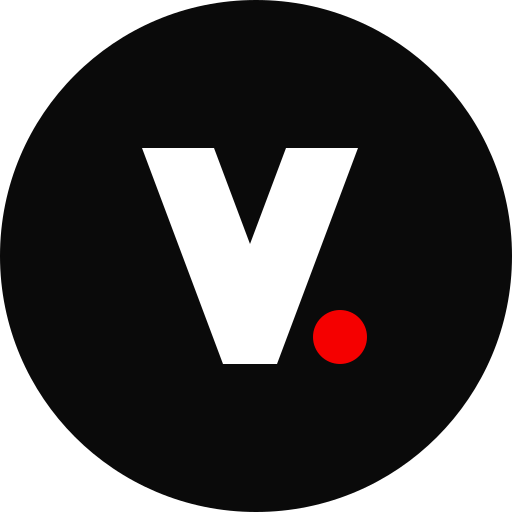
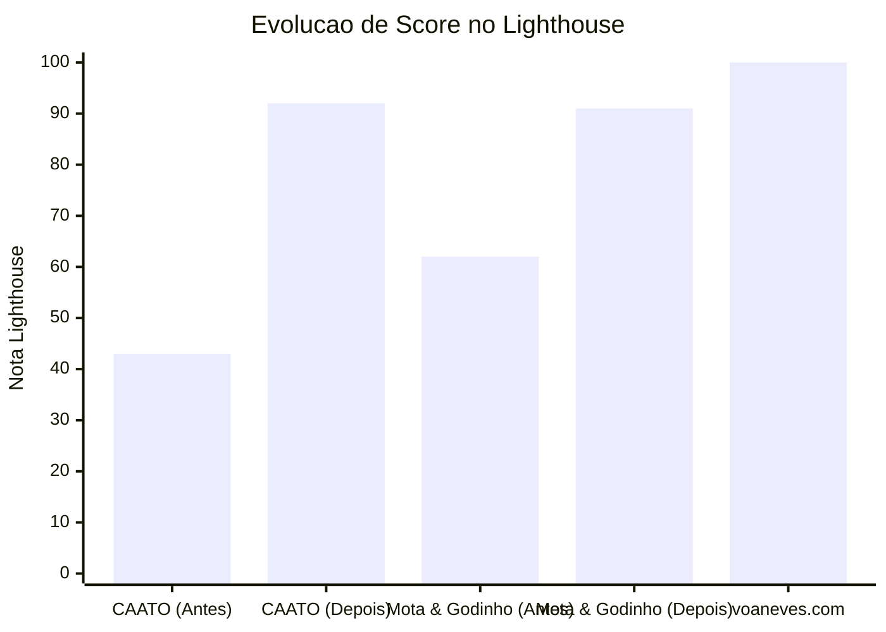
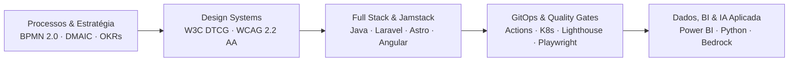
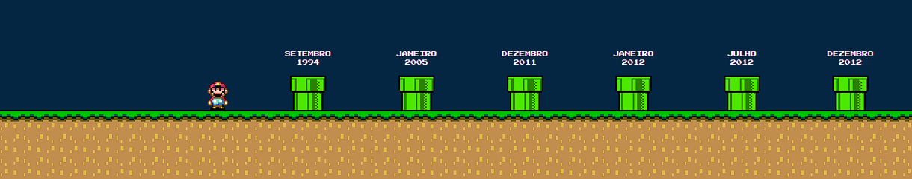

<a href="./README.md" lang="en">English</a> · <strong>Português (PT-BR)</strong>

<a href="https://voaneves.com">
  <picture>
    <source media="(prefers-color-scheme: dark)" srcset="https://raw.githubusercontent.com/voaneves/voaneves/main/assets/brand/mark-dark.svg" />
    <source media="(prefers-color-scheme: light)" srcset="https://raw.githubusercontent.com/voaneves/voaneves/main/assets/brand/mark-light.svg" />
    
  </picture>
</a>

 

<a href="https://voaneves.com">
  <picture>
    <source media="(prefers-color-scheme: dark)" srcset="https://raw.githubusercontent.com/voaneves/voaneves/main/assets/brand/wordmark-dark.svg" />
    <source media="(prefers-color-scheme: light)" srcset="https://raw.githubusercontent.com/voaneves/voaneves/main/assets/brand/wordmark-light.svg" />
    
  </picture>
</a>

<h3>Victor Neves — Desenvolvedor Full Stack, Design Systems &amp; IA Aplicada</h3>

  <strong>Sinal, não ruído.</strong> Design, dados e código em produção — sem ruído. 
  
    <kbd>W3C DTCG</kbd> · <kbd>WCAG 2.2 AA</kbd> · <kbd>GitOps</kbd> · <kbd>BPMN 2.0</kbd> · <kbd>Amazon Bedrock</kbd> 
    Atendimento no Brasil e no exterior, remoto ou híbrido · <code>voaneves</code> · Atendimento em PT, EN &amp; ES
  

  <a href="https://voaneves.com/#contato"><picture><source media="(prefers-color-scheme: dark)" srcset="https://raw.githubusercontent.com/voaneves/voaneves/main/assets/buttons/hire-pt-dark.svg" /></picture></a>
  <a href="https://voaneves.com/"><picture><source media="(prefers-color-scheme: dark)" srcset="https://raw.githubusercontent.com/voaneves/voaneves/main/assets/buttons/site-pt-dark.svg" /></picture></a>

Precisa de algo assim? <a href="https://voaneves.com/#contato"><strong>Vamos conversar →</strong></a>

  
  
  
  

  <a href="#sobre">Sobre</a> ·
  <a href="#impacto">Em números</a> ·
  <a href="#arquitetura">Fluxo</a> ·
  <a href="#competencias">Competências</a> ·
  <a href="#projetos">Projetos</a> ·
  <a href="#premios">Prêmios</a> ·
  <a href="#contato">Contato</a>

<picture>
  <source media="(prefers-color-scheme: dark)" srcset="https://raw.githubusercontent.com/voaneves/voaneves/main/assets/brand/rule-dark.svg" />
  <source media="(prefers-color-scheme: light)" srcset="https://raw.githubusercontent.com/voaneves/voaneves/main/assets/brand/rule-light.svg" />
  
</picture>

## Sobre

> [!NOTE]
> **Rigor de engenharia com entrega visual mensurável.** Engenheiro Mecânico pela **UNICAMP** (2012–2018), pós-graduado em **BI, Big Data e Inteligência Artificial** pela **Faculdade Focus** (2023–2024) e graduando em **Sistemas de Informação** na **XP Educação** (2023–2027). Programo desde os 11 anos.

Sou **Victor Otávio Andrade das Neves (Victor Neves)** e uno rigor de processos (BPMN), leitura de dados (BI), IA aplicada e engenharia web full stack em entregas em produção — dos tokens de design ao deploy resiliente:

- **Analista Webdesigner @ ALETO** *(mar/2026–)*: design system, desenvolvimento full stack, GitOps e documentação como código.
- **Fundador e Consultor @ [voaneves.com][site-pt]** *(2019–)*: `40+` painéis de BI, sites Jamstack de alta nota no Lighthouse, apps e auditoria WCAG 2.2.
- **Avaliador @ Projeto Centelha** *(2023–)*: avaliador técnico de projetos de Big Data, IA e Engenharia.
- **Ex-Gestor do Escritório de Processos, Analista Técnico e ALI @ SEBRAE Tocantins** *(2022–2026)*[^1]: `+50` processos BPMN 2.0, `+76%` de ganho de produtividade em MPEs e `13+` oficinas de IA.

## Em números

<table>
  <tr>
    <td width="50%" align="center">
      <h3>8+ anos</h3>
      Dados, processos e código em produção
    </td>
    <td width="50%" align="center">
      <h3>40+</h3>
      Projetos web, apps e Jamstack entregues
    </td>
  </tr>
  <tr>
    <td width="50%" align="center">
      <h3>40+</h3>
      Painéis executivos em Power BI e Qlik Sense
    </td>
    <td width="50%" align="center">
      <h3>+50</h3>
      Processos BPMN 2.0 mapeados e otimizados
    </td>
  </tr>
  <tr>
    <td width="50%" align="center">
      <h3>+76%</h3>
      Produtividade de MPEs no 1º ciclo SEBRAE
    </td>
    <td width="50%" align="center">
      <h3>+32%</h3>
      Cumprimento trimestral de metas (OKRs)
    </td>
  </tr>
  <tr>
    <td width="50%" align="center">
      <h3>+236%</h3>
      Crescimento de alcance orgânico no MTE
    </td>
    <td width="50%" align="center">
      <h3>91–100</h3>
      Saltos no Lighthouse: <del>43</del> → <strong>92</strong> · <del>62</del> → <strong>91</strong>
    </td>
  </tr>
</table>

Evolução comprovada de performance web em entregas em produção[^2][^3]:

## Como Design, Dados e Código se Conectam

## O que eu faço

<table>
  <tr>
    <td width="50%" valign="top">
      <h3>1. Desenvolvimento Full Stack e Web</h3>
      
<strong>Back-end:</strong> Java, PHP e Laravel, Python e FastAPI, Node.js, REST, SQL e NoSQL

      
<strong>Front-end e Jamstack:</strong> Angular, React, Next.js, Astro, Vite, TypeScript, JS, HTML5, CSS e Sass; APIs desacopladas, CMS headless e deploy em CDN

      
<strong>Mobile, Edge e Qualidade:</strong> React Native, Flutter, PWA; Cloudflare Pages e Workers, AWS, GCP; Lighthouse CI, Playwright, axe-core, Core Web Vitals e SEO técnico (hreflang, canonical, dados estruturados)

    </td>
    <td width="50%" valign="top">
      <h3>2. Design e Design System</h3>
      
<strong>Tokens e Specs:</strong> Figma, protótipos interativos e design tokens no padrão W3C <strong>DTCG 2025.10</strong>

      
<strong>Arquitetura:</strong> CSS por tokens, bibliotecas de componentes, ADRs e identidade visual empacotada via npm

      
<strong>Acessibilidade:</strong> Auditoria automatizada <strong>WCAG 2.2 AA</strong> e APCA-W3 da fonte JSON até a UI renderizada

    </td>
  </tr>
  <tr>
    <td width="50%" valign="top">
      <h3>3. Infraestrutura, GitOps e Entrega</h3>
      
<strong>GitOps:</strong> Estado desejado em repositório, deploy por merge e rollback determinístico por revert

      
<strong>CI/CD e Contêineres:</strong> GitHub Actions, Forgejo Actions, Docker, Docker Compose e manifestos <strong>Kubernetes</strong>

      
<strong>Governança:</strong> Hospedagem em Cloudflare, AWS e GCP; docs-as-code e segredos sempre fora do Git

    </td>
    <td width="50%" valign="top">
      <h3>4. Dados, BI e IA Aplicada</h3>
      
<strong>BI e Modelagem:</strong> Power BI, Qlik Sense e Tableau (<code>40+</code> painéis); SQL, NoSQL, Hadoop e MongoDB

      
<strong>Ciência de Dados:</strong> Python, Pandas, NumPy, Jupyter, Julia, pipelines ETL e otimização linear

      
<strong>IA e ML:</strong> LLMs com Amazon Bedrock, engenharia de prompt, automações (<code>13+</code> oficinas), Reinforcement Learning (DQN), CNNs e NLP

    </td>
  </tr>
  <tr>
    <td colspan="2" valign="top">
      <h3>5. Processos, Gestão e Estratégia</h3>
      
<strong>BPM e Qualidade:</strong> <strong>BPMN 2.0</strong> (<code>+50</code> processos), mapeamento AS-IS/TO-BE, automação low-code, Lean Six Sigma Green Belt, <strong>DMAIC</strong>, Scrum, Kanban e controle de riscos · <strong>Estratégia:</strong> OKRs (<code>+32%</code> metas), Balanced Scorecard, Matriz BCG, McKinsey 7S, SWOT e metodologia SEBRAE (<code>+76%</code>).

    </td>
  </tr>
</table>

Fonte única de posicionamento e palavras-chave: [`brand/docs/perfil-tecnico.md`][brand-perfil][^4] · Padrão visual: [`README Brand System`](./docs/README-BRAND-SYSTEM.md).

## Projetos em destaque

<table>
  <tr>
    <td width="50%" valign="top">
      <h3><a href="https://github.com/voaneves/dtcg-contrast">dtcg-contrast</a></h3>
      
Quality gate WCAG 2.2 &amp; APCA sem dependências, relatório SARIF 2.1.0 e corretor automático em OKLCH para design tokens W3C DTCG 2025.10.

      
<a href="https://www.npmjs.com/package/dtcg-contrast"><strong>Pacote npm</strong></a> · <a href="https://github.com/voaneves/dtcg-contrast"><strong>GitHub Action</strong></a>

    </td>
    <td width="50%" valign="top">
      <h3><a href="https://github.com/voaneves/brand">brand (@voaneves/brand)</a></h3>
      
Identidade visual e design system em W3C DTCG: marca Sinal (Conceito B), tokens, CSS em camadas, ES modules, ícones e contraste WCAG 2.2 AA.

      
<a href="https://github.com/voaneves/brand"><strong>Explorar Design System</strong></a>

    </td>
  </tr>
  <tr>
    <td width="50%" valign="top">
      <h3><a href="https://github.com/voaneves/site">site (voaneves.com)</a></h3>
      
Portfólio bilíngue de consultoria em Astro, Cloudflare Pages, fluxos GitOps, testes automatizados com Playwright e nota 100 no Lighthouse.

      
<a href="https://voaneves.com"><strong>Acessar site</strong></a> · <a href="https://voaneves.com/#projetos"><strong>Estudos de caso</strong></a>

    </td>
    <td width="50%" valign="top">
      <h3><a href="https://github.com/voaneves/snake-arena">snake-arena</a></h3>
      
Benchmark reprodutível em Keras 3 comparando 14 algoritmos de Reinforcement Learning no jogo Snake, validado com 1.383 testes automatizados.

      
<a href="https://github.com/voaneves/snake-arena"><strong>Ver Benchmark</strong></a>

    </td>
  </tr>
</table>

  
<strong>Mais ferramentas open-source, jogos e sites</strong>

  | Projeto | Em uma linha | Demo |
  | :-- | :-- | :-- |
  | 🎮 [**snake-on-pygame**](https://github.com/voaneves/snake-on-pygame) | Snake em Python e Pygame jogável por humano ou agente DQN treinado | [Docs](https://voaneves.github.io/snake-on-pygame/) |
  | 🎧 [**paru-site**](https://github.com/voaneves/paru-site) | Site oficial do DJ e produtor PARU em Vite, React e TypeScript | [Acessar site](https://voaneves.github.io/paru-site/) |
  | 🏰 [**travian-building-order**](https://github.com/voaneves/travian-building-order) | Otimizador algorítmico da fila de construção de vilas no Travian | [Abrir app](https://voaneves.github.io/travian-building-order/) |
  | 🐷 [**meupoupig**](https://github.com/voaneves/meupoupig) | Jogo educativo interativo de educação financeira e investimentos (PWA) | [Jogar aqui](https://voaneves.github.io/meupoupig/) |

Estudos de caso completos (MTE, painéis de BI, CAATO, Mota &amp; Godinho, Boas Obras) em [voaneves.com/#projetos][portfolio-pt] · [Todos os repositórios][all-repos].

## Reconhecimentos

Resumo em bootcamps: **4× 1º lugar + 1× 2º lugar** em trilhas nacionais de engenharia e IA.

- 🥇 **1º lugar** no Santander Bootcamp 2025: Back-End com Python (FastAPI, Docker, MongoDB).
- 🥈 **2º lugar** no Santander Bootcamp 2025: Ciência de Dados com Python.
- 🥇 **1º lugar** no Santander 2024: Preparatório para Certificação AWS (Cloud Practitioner).
- 🥇 **1º lugar** no Bootcamp Nexa 2024: Fundamentos de IA Generativa (AWS, Amazon Bedrock).
- 🥇 **1º lugar** no Santander Bootcamp 2023: Ciência de Dados com Python (entre **17.600 participantes**).
- 🥇 **1º lugar** em "Estratégia em Alto Mar" (SEBRAE Tocantins, 2024).
- 🎓 **Certificações:** Lean Six Sigma Green Belt · Google Project Management e Data Analytics · University of Cambridge (*Skills for the Green Transition*) · PwC (*Data-driven Decision Making* e Excel avançado) · Preparatório AWS e IA Generativa (DIO, AWS, Amazon Bedrock) · Accenture e Huawei ICT Academy (IA) · EF SET Inglês C2 (84/100).

  
<strong>🧬 Trajetória profissional e formação completa (2012–Atual · 11 experiências)</strong>

  | Quando | Onde | O quê |
  | :-- | :-- | :-- |
  | 2026– | **ALETO** | Analista Webdesigner: design system, desenvolvimento full stack, GitOps e documentação como código |
  | 2023–2027 | **XP Educação** | Bacharelado em Sistemas de Informação |
  | 2023–2024 | **Faculdade Focus** | Pós-graduação em BI, Big Data e Inteligência Artificial |
  | 2023– | **Projeto Centelha** | Avaliador de projetos de Big Data, IA e Engenharia |
  | 2022–2026 | **SEBRAE Tocantins** | Agente Local de Inovação (2022), Analista Técnico (2023) e Gestor do Escritório de Processos (2024): `+76%` produtividade em MPEs, `+50` processos BPMN 2.0, `+32%` metas trimestrais, `13+` oficinas de IA |
  | 2019– | **voaneves.com** | Consultor e Web Developer: `40+` painéis de BI, sites e apps |
  | 2019–2022 | **Damásio Educacional** | Supervisor de Franquia |
  | 2017–2019 | **Coca-Cola FEMSA** | Estágio em manutenção (DMAIC) e trainee de planejamento estratégico |
  | 2014–2018 | **MTE (UNICAMP)** | Membro e Diretor de Marketing (`+236%` de alcance orgânico) |
  | 2018 | **Krones AG**, Alemanha | Summer Intern em Engenharia Industrial |
  | 2012–2018 | **UNICAMP** | Engenharia Mecânica e iniciação científica em Materiais (PIBIC/CNPq) |

  
<strong>🌎 Idiomas, voluntariado e linha do tempo Super Mario World</strong>

  - 🗣️ Português (nativo) · Inglês C2 (EF SET 84/100) · Espanhol C1 · Coreano B1 · Alemão A2.
  - 📚 Mangás, manhwas, animes e jogos online (foi por eles que aprendi inglês).
  - 🗺️ Google Local Guide nível 6.
  - 🤝 Voluntário desde 2013: ONG Sonhar Acordado e ONG Boas Obras, onde criei o site da organização.
  - 🍄 [Minha linha do tempo interativa no estilo Super Mario World](https://voaneves.github.io/timeline/)

  

## Contato

<dl>
  <dt><strong>Design Systems &amp; Auditorias de Acessibilidade</strong></dt>
  <dd>Pipelines de tokens W3C DTCG 2025.10, auditorias técnicas WCAG 2.2 AA / LBI / EAA, contraste perceptual APCA e bibliotecas de UI do Figma ao código.</dd>
  <dt><strong>Plataformas Web &amp; Full Stack</strong></dt>
  <dd>Sites e aplicações em produção com Astro, Angular, Laravel, Java e Cloudflare Pages/Workers focados em Core Web Vitals e Lighthouse 90+.</dd>
  <dt><strong>GitOps, BI &amp; IA Aplicada</strong></dt>
  <dd>Quality gates automatizados em CI/CD (Lighthouse CI, Playwright, axe-core), painéis executivos Power BI e automações com LLMs (Amazon Bedrock).</dd>
</dl>

  <a href="https://voaneves.com/#contato"><picture><source media="(prefers-color-scheme: dark)" srcset="https://raw.githubusercontent.com/voaneves/voaneves/main/assets/buttons/hire-pt-dark.svg" /></picture></a>
  <a href="https://voaneves.com/"><picture><source media="(prefers-color-scheme: dark)" srcset="https://raw.githubusercontent.com/voaneves/voaneves/main/assets/buttons/site-pt-dark.svg" /></picture></a>

  <strong>Brasil e exterior · Remoto ou híbrido</strong> 
  <a href="https://www.linkedin.com/in/voaneves/">LinkedIn</a> ·
  <a href="mailto:victorneves478@gmail.com">E-mail</a>

  
   
  <strong>VOANEVES.</strong> · Sinal, não ruído. · <a href="https://voaneves.com">voaneves.com</a>

<a href="#top">↑ Voltar ao topo</a>

[^1]: Resultados apurados no SEBRAE Tocantins (`+76%` produtividade de MPEs no 1º ciclo, `+50` processos BPMN 2.0 e `+32%` metas trimestrais).
[^2]: Projetos web da CAATO e Mota &amp; Godinho documentados em [voaneves.com/#projetos](https://voaneves.com/#projetos).
[^3]: Crescimento orgânico (`+236%`) na Diretoria de Marketing da MTE (UNICAMP).
[^4]: Fonte única de posicionamento técnico mantida em [`@voaneves/brand`](https://github.com/voaneves/brand/blob/main/docs/perfil-tecnico.md).

[site-pt]: https://voaneves.com
[portfolio-pt]: https://voaneves.com/#projetos
[brand-perfil]: https://github.com/voaneves/brand/blob/main/docs/perfil-tecnico.md
[all-repos]: https://github.com/voaneves?tab=repositories
